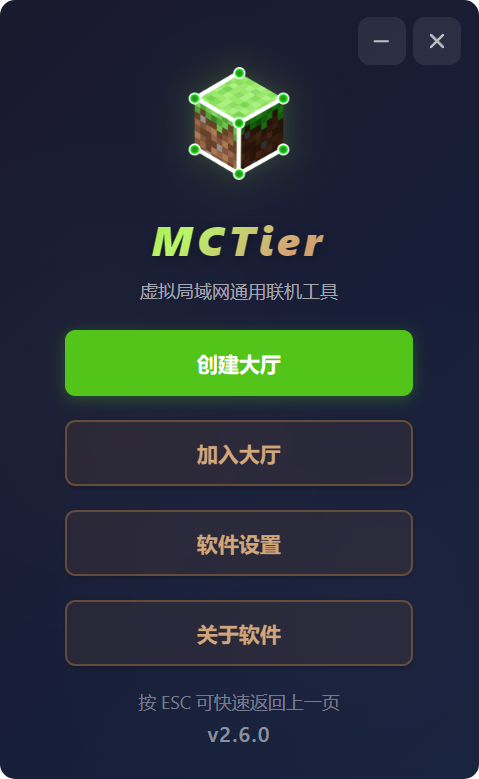
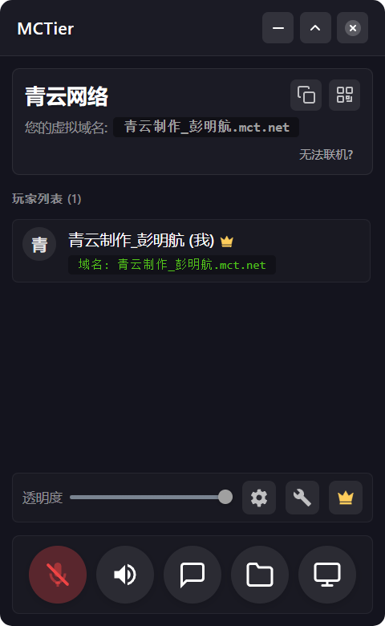
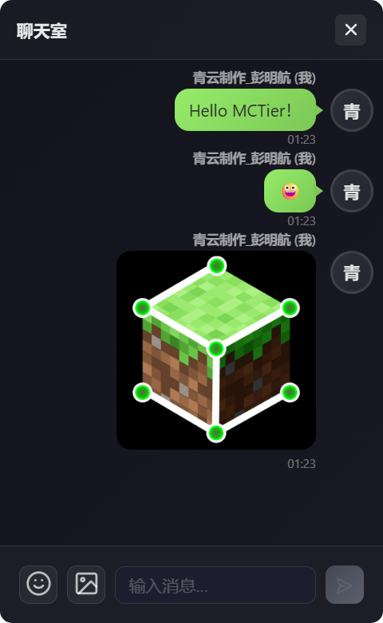
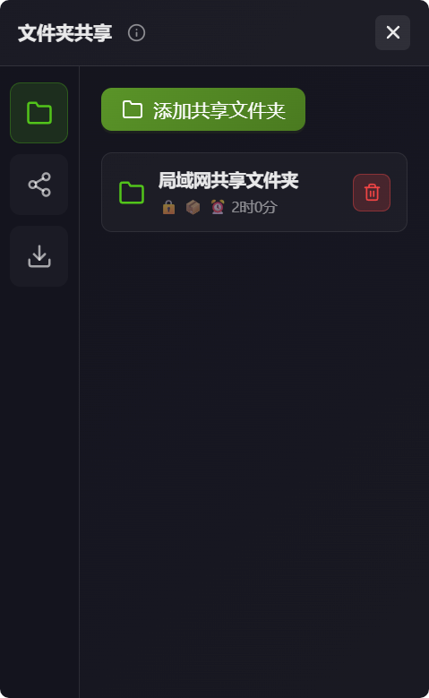
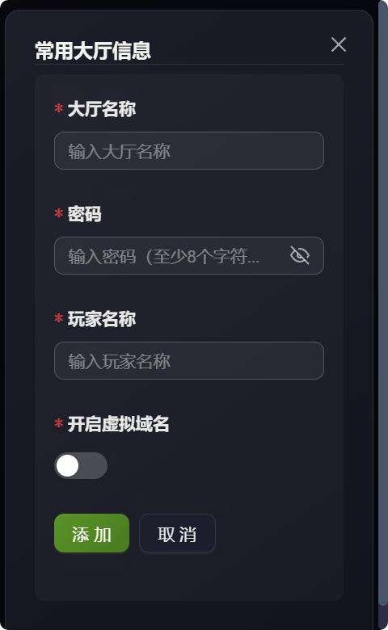
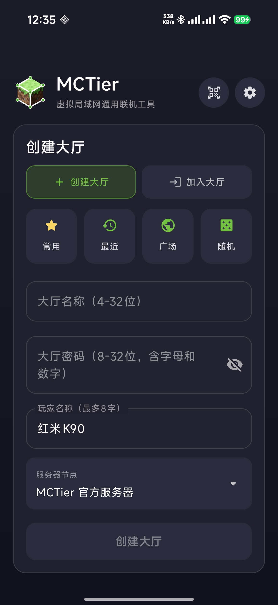
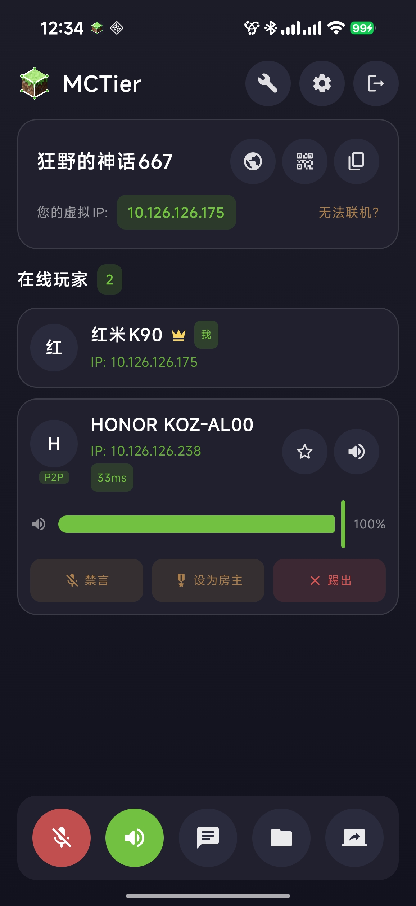
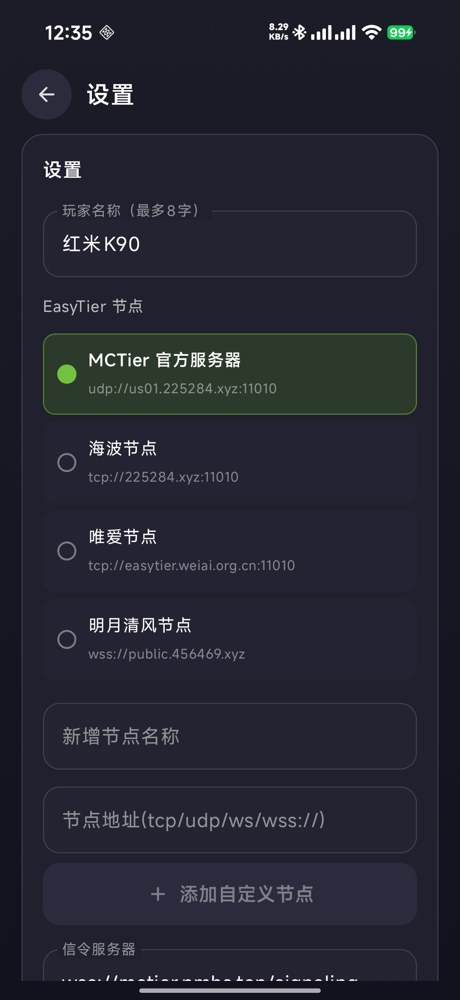
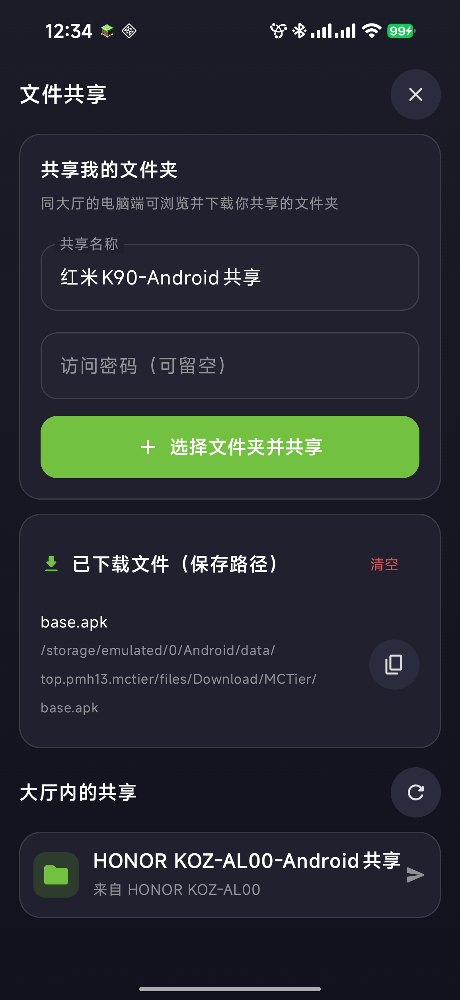
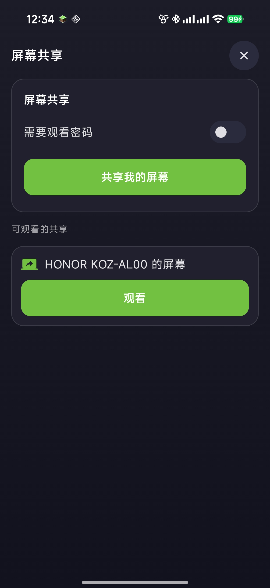

<a id="overview"></a>

# Boat Chris Craft Launcher

**BCCL Alpha 0.2.2**，Windows Minecraft 启动器。

个性化提供 13 种常驻配色，浅色与深色模式可分别选择；原“龙猫蓝”显示为“PCL蓝”，已有配色设置继续沿用。联机原生窗口进入时使用 240 毫秒的轻微上移过渡，切换页面保留后台会话和预加载，液态玻璃效果及选项不变。

- [GitHub](https://github.com/123ugbu1312u/Boat-Chris-Craft-Launcher)
- [GitCode](https://gitcode.com/BoatMinecraft/BoatChrisCraftLauncher)

支持游戏安装、实例管理、Java 与账号配置、模组资源下载，以及跟随启动器主题的 Liquid Glass 界面。


## 目录

- [下载](#下载)
- [联机](#联机)
- [源码目录](#源码目录)
- [构建](#构建)
- [验证与许可](#验证与许可)
- [BCCL.Core 核心库](#core)
- [数据库开发指南](#database)
- [动画回归与分配验证](#verify-animation)
- [CPU 优化原生验证](#verify-cpu)
- [原版下载验证](#verify-download)
- [Java 下载验证](#verify-java)
- [本地模组列表验证](#verify-mods)
- [联机验证](#verify-multiplayer)
- [MCTier 上游项目说明](#mctier)
- [MCTier Android 构建](#mctier-android)
- [MCTier Linux 构建与限制](#mctier-linux)

## 下载

下载导航分为可独立折叠的自动安装、社区资源、Java 下载器和手动安装四个板块。Java 下载器在线合并 Adoptium 版本目录与 Oracle 下载页中的版本信息，选择版本和父目录后，再确认 Oracle（默认）或 OpenJDK（Eclipse Temurin）。完整 Windows x64 JDK 校验 SHA-256 后解压到 `Java版本号/bin`、`Java版本号/lib` 等目录，保留许可证，不覆盖已有安装；支持取消并清理临时文件，安装成功后添加到 Java 管理。

Oracle 需要官网账号的版本会提供官网入口或 OpenJDK 选择。版本出现在目录中不代表两家均已提供该版本的免登录 Windows ZIP，暂未提供时会显示错误并允许重试。官方来源：[Oracle](https://www.oracle.com/java/technologies/downloads/)、[Adoptium API](https://api.adoptium.net/q/swagger-ui/)。验证入口为 `scripts/JavaDownloadVerification`。

## 联机

联机页内嵌完整 MCTier 3.10.0，保留原版房间、聊天、文件共享、语音、屏幕共享、远程控制和房间工具。界面使用本地 WebView，嵌入启动器窗口；尚未改为全部 WPF 原生控件。

适配包括背景随启动器主题变化、内容随窗口尺寸调整、BCCL 名称与图标，以及移除赞助、关于软件、启动推广、可选更新提示和不适用于内嵌场景的独立窗口设置。必要的权限与远程控制确认保留。切换启动器页面保留组件进程，退出启动器时执行组件清理。

原项目：[MCTier](https://github.com/pmh1314520/MCTier)，原作者 MCTier Team。当前固定上游提交为 `d6af338e793941e15b777ec8abf6c9109d9591b1`。适配源码放在 `ThirdParty/MCTier`，原许可和第三方声明保留在其 `LICENSE`、`THIRD_PARTY_NOTICES.txt`、`licenses`，以及本仓库 `Licenses/MCTier`。

旧 WPF 联机页保留供回溯，已退出主导航；它使用不同的媒体与通信实现，不能作为完整原版兼容性的替代。

## 源码目录

| 目录 | 内容 |
| --- | --- |
| `BCCL` | WPF 启动器，程序集和命名空间为 BCCL |
| `BCCL.Core` | 核心库 |
| `BCCL.Core.SourceGenerators` | 源码生成器 |
| `BCCL.Core.Test` | 核心测试 |
| `ThirdParty/MCTier` | 固定版本的原版联机源码及适配 |
| `scripts` | 构建、打包及验证工具 |
| `Licenses` | 上游及第三方许可 |

解决方案入口为 `BCCL.slnx`。构建缓存放在源码目录旁的 `Temp` 中。运行数据、账号配置、日志、备份、源码归档和编译产物不作为源码上传。全部项目说明合并在根目录 `README.md`，子目录不再单独保留 Markdown 文件。

## 构建

启动器构建使用 Windows x64、.NET 10 SDK 和 PowerShell 7；发布目标为 .NET 8 Windows Desktop，自带运行时。

完整联机组件还需要 Node.js（执行 `npm ci`）、Rust MSVC 工具链、Visual C++ 编译工具、Windows SDK、CMake、Ninja 与 libclang。`scripts/MCTier/Build-Embedded.ps1` 使用位于源码目录旁 `Temp/MCTier-embedded/Tools` 的工具布局，路径配置见脚本开头。`prepare-portable-tools.py` 可准备 MSVC/SDK 等依赖，需预先准备 Python、Rust、CMake、Ninja、libclang。该脚本不是机器全局安装程序。

在本仓库根目录运行：

```powershell
Push-Location ThirdParty/MCTier
npm ci
Pop-Location
./scripts/MCTier/Build-Embedded.ps1
./scripts/Publish-BCCL.ps1 -AllowUnconfiguredMicrosoftLogin
```

`Prepare-Assets.ps1` 从固定上游提交下载内置表情资源，并校验 SHA-256；该大文件不直接纳入本源码仓库。`Prepare-Runtime.ps1` 校验官方便携包和 EXE 后提取 EasyTier、Wintun、WinDivert。语音依赖及模型由原版准备脚本下载并校验。运行时仍保留原版组件校验。

发布默认输出到源码目录旁的 `Temp/release`，入口为 `Boat Chris Craft Launcher.exe`。发布脚本将完整联机程序、资源、驱动和许可一起封装到启动器内，只需复制这一个 EXE。首次打开联机时自动准备到用户本地缓存 `BCCL/Multiplayer/Runtime`，不需要外置 `Extensions` 文件夹，也不在首次运行时下载这些组件；后续校验并复用缓存，文件损坏时从 EXE 内置资源修复。运行数据和缓存仍会按正常软件行为写入磁盘。

表情包沿用原版联机程序内的 Windows 资源，不在外层重复封装。打包前校验内置副本的长度和 SHA-256 与原资源一致；网络引擎、驱动、语音模型、表情内容和许可均保留。启动器启用 .NET 单文件无损压缩，仍为完整自带运行时的版本，不启用程序集裁剪。发布脚本默认要求最终 EXE 小于 250,000,000 字节，不通过裁剪功能或首次联网下载来缩小文件。后台预加载、液态玻璃的折射、色散、动画及全部设置选项保持原有实现。

BCCL 主界面首次显示后，在后台准备并预加载联机。原生窗口保持隐藏，页面完成初始化和主题同步后才允许嵌入显示；加载底色跟随启动器，避免白底、黑底交替。预加载与提前点击联机共用同一次启动，自动加入大厅仅在进入联机页后触发，退出 BCCL 同时清理后台组件。

Microsoft 正版登录的公开 Client ID 可在启动器“正版登录设置”中填写，也可通过构建参数 `-MicrosoftClientId` 提供。无内置 ID 时使用上述 `-AllowUnconfiguredMicrosoftLogin`，之后在界面配置。不要提交本地 OAuth 配置、令牌或密钥。

## 验证与许可

`scripts` 下保留独立验证工具；MCTier 前端测试在 `ThirdParty/MCTier` 中运行 `npm test`。加载成功或单机测试不代表双机语音、共享、文件传输、远程控制全部通过。

单文件包启用完整运行依赖解压，确保 WPF 提示框所需的 Accessibility 与延迟加载库具有稳定的磁盘路径；首次运行会准备缓存。`scripts/Packaging/Test-PopupPackage.ps1` 在无外置 DLL、全新解压缓存、无已安装运行时路径的目录内验证程序集加载及透明 Popup，并覆盖 EXE 被重命名后的延迟加载。该测试通过 `--verify-popup` 入口执行，不启动账号、配置或启动器后台服务。

启动器上游许可见根目录 `LICENSE`、`BCCL/LICENCE` 和 `Licenses`。MCTier 使用其原非商业许可；各第三方依赖遵循各自许可。本仓库的上传不改变原作者署名或许可条款。

---

<a id="core"></a>

## BCCL.Core 核心库

源码目录：`BCCL.Core`。

<a id="core--bcclcore"></a>

这是为 BCCL 版本特别开发的核心库，由社区开发与维护


<a id="core--协议"></a>

### 🔒 协议

遵循 Apache License 2.0 开源协议

---

<a id="database"></a>

## 数据库开发指南

源码目录：`BCCL.Core/App/Database`。

<a id="database-database-guildline"></a>
This is a light database management guildline for BCCL.Core. It is not a strict rule, but a recommendation to follow.

<a id="database-how-to-create-a-new-database"></a>

### How to create a new database
1. You need create a class that inheritance from `DatabaseEntry`.
2. Then make a ctor that call `base(<connPath>)` with the connection path.
3. Now this class is ready to use. (Yes it is that simple, and will automatically create the database file if not exists)


<a id="database-databaseentry"></a>

### DatabaseEntry
The `DatabaseEntry` class is the entrance to use the database.
User must implement a class that inheritance from `DatabaseEntry` to use it.
And the child class should implement there own method to provide some ways to interact with the database.


<a id="database-a-normal-example"></a>

### A Normal Example
```charp
public class UserDatabase : DatabaseEntry
{
	public UserDatabase() : base("example.db")
	{
		// You can do some initialization here.
		// Like create table if not exists,
		// or anything else.
	}


	public List<(int Id, string Name, int Age)> GetAllUsers()
	{
		// In your method, you shoul provide some way to interact with the database.
	}
}
```
Then, you can use it like this:
```charp
var db = new UserDatabase();
var users = db.GetAlUsers();
```

---

<a id="verify-animation"></a>

## 动画回归与分配验证

源码目录：`scripts/AnimationVerification`。

<a id="verify-animation-动画回归与分配验证"></a>

在源码根目录运行：

```powershell
dotnet run --project scripts/AnimationVerification -c Release -- --measure
```

直接调用主项目的动画实现，检查 WPF 控件、阴影、画刷和自定义对象的透明度，X/Y 位移，依赖属性，星号列宽，尺寸，颜色动画结束后的动态资源引用，文字，延迟/顺序与同名动画替换。

玻璃交互回归检查按钮、导航按钮与卡片在页面禁用点击检测、卸载及重新加载时始终绑定各自宿主，避免点击一个按钮时其他控件一起播放动画。

左侧导航回归覆盖无内容与折叠状态的 Expander、无内容与文本内容的 ContentControl，反复执行入场和退场，确保空内容不会中断整个页面切换。

胶囊操作条使用实际 WPF 命中测试，检查三种尺寸下四角空白均不响应、中央和两端仍可命中，覆盖子控件矩形背景与尺寸变化。

只注册配置定义，不启动启动器服务或读取账号。`--measure` 额外运行 128 组透明度动画、预热 20 帧、测量 300 帧，输出当前线程分配量和耗时。这是动画压力场景，不代表首页常驻内存或整机 CPU 降幅。比较旧版时应使用同一测试程序、配置和运行时。

---

<a id="verify-cpu"></a>

## CPU 优化原生验证

源码目录：`scripts/CpuOptimizationVerification`。

<a id="verify-cpu-cpu-优化原生验证"></a>

在源码根目录运行：

```powershell
dotnet run --project scripts/CpuOptimizationVerification -c Release -- --native ../Temp/cpu-verification
```

使用生产协调器和核心 Windows API，运行 22 项验证：设置失败回滚、插电/电池模式回读、游戏 HighQoS/优先级/动态提升、核心亲和性不变、新游戏自动应用、状态持久化、恢复原值、尊重外部电源修改，以及启动器进程退出后由新进程恢复仍运行游戏的原设置。

该命令会短暂更改实际 Windows 性能电源模式，并对工具自行创建的等待进程应用游戏策略。测试结束时恢复原电源和进程设置，不使用真实 Minecraft。运行前将电源快照写到指定隔离目录的 `power-before.json`；正常完成时输出所有检查通过和已恢复提示。此工具不是单核跑分，不提供 FPS 或性能提升百分比。

---

<a id="verify-download"></a>

## 原版下载验证

源码目录：`scripts/DownloadVerification`。

<a id="verify-download-原版下载验证"></a>

在 GPTcode 运行：

```powershell
dotnet run --project scripts/DownloadVerification -c Release -- ../Temp/vanilla-download-verification --live
```

直接编译生产下载器、分段恢复、源采样及共享额度代码，使用隔离的配置、日志、请求签名与文件校验适配器，不加载启动器账号或修改游戏目录。默认验证 20 MiB 分段文件、Range 不支持时回退、取消后清理；`--live` 额外从官方清单获取 1.21.1 客户端、16 个资源和 8 个支持库，并对大小及 SHA-1 独立核验。输出都位于指定目录。

---

<a id="verify-java"></a>

## Java 下载验证

源码目录：`scripts/JavaDownloadVerification`。

<a id="verify-java-java-下载验证"></a>

在源码目录执行：

```powershell
dotnet run --project scripts/JavaDownloadVerification -- ../Temp/java-download-check --live
```

使用本地 HTTP 测试完整下载、校验、解压、中文和空格路径、不覆盖已有安装、取消清理以及 ZIP 路径穿越。测试包中的 EXE 是文本占位，不执行程序。`--live` 额外验证官方版本列表、Temurin Java 8 和 Oracle 最新版本的下载元数据及校验值，不下载完整在线 JDK。

同时添加 `--install` 会将 Oracle 最新 JDK 下载、校验并解压到测试目录下的 `LiveOracle/Java版本号`，不会注册到用户 Java 配置或运行安装包。

---

<a id="verify-mods"></a>

## 本地模组列表验证

源码目录：`scripts/LocalModListVerification`。

<a id="verify-mods-本地模组列表验证"></a>

在 Windows x64、.NET 10 SDK 下，从源码根目录运行：

```powershell
dotnet run --project scripts/LocalModListVerification -c Release -- --verify
```

使用真实 WPF 控件、应用资源和生产列表代码；配置提供方在内存中，不读取账号，不启动联网详情加载，不改动现有游戏文件。启停用夹具只写入输出目录下的 `verification-data`。

默认测量 128 / 1000 条合成记录的构建、刷新与布局：优化版仅创建前 24 行内容，全部行仍保留身份和选择状态。`--verify` 运行 17 项回归，覆盖最后一行滚动补齐、屏幕外全选、筛选、搜索、排序、Minecraft 文本格式、屏幕外模组启停用及共享加载器结果归属。回归在 WPF 消息循环内执行。

2026-11-04 同机 Release 测量：128 行约 340.8 → 113.5 ms，1000 行约 2429.3 → 73.7 ms。此数字仅表示界面构建/刷新/布局耗时，不代表整合包从打开到可操作的总时间；每次运行会有波动。原始日志与源码/EXE 备份保存在工作区上级 `Temp/local-mod-list-speed`。

---

<a id="verify-multiplayer"></a>

## 联机验证

源码目录：`scripts/MultiplayerVerification`。

<a id="verify-multiplayer-联机验证"></a>

在源码根目录运行：

```powershell
dotnet test BCCL.Core.Test/BCCL.Core.Test.csproj -c Release --filter FullyQualifiedName~MCTierRoomTest
dotnet build scripts/MultiplayerVerification/MultiplayerVerification.csproj -c Release -o ../Temp/MCTier-integration/Verification
../Temp/MCTier-integration/Verification/MultiplayerVerification.exe --verify-ui
../Temp/MCTier-integration/Verification/MultiplayerVerification.exe --network '<包含 easytier-core.exe、easytier-cli.exe、Packet.dll、WinDivert64.sys、wintun.dll 的目录>'
../Temp/MCTier-integration/Verification/MultiplayerVerification.exe --session
../Temp/MCTier-integration/Verification/MultiplayerVerification.exe --directory-live
../Temp/MCTier-integration/Verification/MultiplayerVerification.exe --verify-name-live
../Temp/MCTier-integration/Verification/MultiplayerVerification.exe --managed-session-live
```

`--network` 在隔离数据目录运行两个真实的免网卡 EasyTier 实例，经本机 TCP 节点发现、SOCKS、本机游戏入口和虚拟 IP 传送数据并检查返回值，最后关闭自己创建的两个核心。`--session` 使用前一步准备的隔离运行时，验证生产代码的私有命名管道、辅助进程、核心 RPC 及断开清理。两项均不创建系统网卡或修改防火墙。

不传参数时打开独立的原生页面验证窗口，使用内存配置提供程序和 `verification-data`，不会启动完整启动器生命周期或读取玩家账号。关闭验证窗口后可重新构建。此工具不代表真实公网双机 Minecraft 对局验证，也不自动处理 Windows UAC 授权。

`--verify-ui` 在内存配置与隔离会话中验证首页、创建/加入切换、自动邀请解析、手动无密码加入、高级端口绑定、错误提示、已连接界面和手动地址保护。布局检查使用与主窗口相同的 Auto 左栏，在 740/900/1260 像素内容区宽度验证左栏固定宽度与右侧可用空间。

三个 `*-live` 检查会访问默认名称服务，只使用随机生成的 `BCCL-*-QA-...` 私有测试房间，并在结束时释放。`--directory-live` 验证签名注册、不同密码的同名创建被拒绝、地址转交、按名称加入和名称释放；`--verify-name-live` 通过实际 WPF 输入事件验证自动检测、重名提示、快速修改与退出释放；`--managed-session-live` 使用实际辅助进程与 EasyTier 核心确认名称登记和虚拟地址，需先通过 `--network` 准备隔离组件。它们不发布公开大厅、不发送聊天消息、不创建系统网卡。

---

<a id="mctier"></a>

## MCTier 上游项目说明

源码目录：`ThirdParty/MCTier`。

本节保留固定上游版本的独立客户端说明、作者署名、许可、服务披露及支持信息。BCCL 的内嵌适配与构建入口见本文开头；本节命令在 `ThirdParty/MCTier` 目录中执行。

<div align="center">
  

<a id="mctier-mctier"></a>

  **虚拟局域网通用组网工具**

  <p>
    
    
    
    
  </p>

  **支持 Windows 10/11 与 Android。电脑端和手机端可加入同一个大厅，快速组成跨网络虚拟局域网。**

  [GitHub](https://github.com/pmh1314520/MCTier) · [Gitee](https://gitee.com/peng-minghang/mctier) · [快速开始](#mctier-快速开始) · [运行预览](#mctier-运行预览) · [赞助支持](#mctier-赞助支持)

  [English](https://github.com/pmh1314520/MCTier/blob/d6af338e793941e15b777ec8abf6c9109d9591b1/README_EN.md) | 简体中文
</div>

<table>
  <tr>
    <td align="center" width="160">
      <a href="https://langlangy.cn/?imctier" target="_blank" rel="noopener">
        <picture>
          <source media="(prefers-color-scheme: dark)" srcset="ThirdParty/MCTier/public/langlangyun-logo-white.png">
          <source media="(prefers-color-scheme: light)" srcset="ThirdParty/MCTier/public/langlangyun-logo-black.png">
          
        </picture>
      </a>
    </td>
    <td>
      <sub>广告赞助</sub><br>
      <a href="https://langlangy.cn/?imctier"><strong>浪浪云 BGP 服务器 · 让游戏组网延迟更低更快</strong></a><br>
      自建信令服务器或游戏服务器？了解浪浪云的云服务器方案。
    </td>
  </tr>
</table>

---


<a id="mctier-项目简介"></a>

### 项目简介

MCTier 基于 EasyTier 与 WebRTC，用来把不同网络环境下的设备组到同一个虚拟局域网中。它不是 Minecraft 专属工具，也不只服务游戏场景；只要你需要跨网络访问局域网服务、临时协作、语音沟通、文件夹共享或屏幕共享，都可以用 MCTier 搭一个轻量大厅。

典型用途包括：

- 局域网游戏联机，例如 Minecraft、泰拉瑞亚、饥荒等。
- 跨网络访问本地服务，例如开发调试页面、局域网后台、临时 HTTP 服务。
- 小团队临时协作，例如语音频道、聊天室、文件夹共享、屏幕共享。
- 手机与电脑互联，例如手机扫码加入大厅、复制邀请链接加入组网。


<a id="mctier-运行预览"></a>

### 运行预览

预览图按桌面端与手机端分组，尽量用紧凑布局展示，避免图片过多导致阅读很累。


<a id="mctier-windows-端"></a>

#### Windows 端

<table>
  <tr>
    <td align="center" width="50%">
      <br>
      <b>主界面</b>
    </td>
    <td align="center" width="50%">
      <br>
      <b>大厅界面</b>
    </td>
  </tr>
  <tr>
    <td align="center" width="50%">
      <br>
      <b>聊天室</b>
    </td>
    <td align="center" width="50%">
      <br>
      <b>文件夹共享</b>
    </td>
  </tr>
  <tr>
    <td align="center" width="50%">
      <br>
      <b>屏幕共享</b>
    </td>
    <td align="center" width="50%">
      <br>
      <b>设置中心</b>
    </td>
  </tr>
</table>

<details>
<summary><b>查看更多 Windows 端预览</b></summary>

<table>
  <tr>
    <td align="center"><br><b>创建大厅</b></td>
    <td align="center"><br><b>加入大厅</b></td>
    <td align="center"><br><b>常用大厅</b></td>
  </tr>
  <tr>
    <td align="center" colspan="3"><br><b>大厅动态设置</b></td>
  </tr>
</table>
</details>


<a id="mctier-android-端"></a>

#### Android 端

<table>
  <tr>
    <td align="center"><br><b>主界面</b></td>
    <td align="center"><br><b>大厅界面</b></td>
    <td align="center"><br><b>大厅二维码</b></td>
    <td align="center"><br><b>设置</b></td>
  </tr>
  <tr>
    <td align="center"><br><b>聊天室</b></td>
    <td align="center"><br><b>文件夹共享</b></td>
    <td align="center"><br><b>屏幕共享</b></td>
    <td align="center"><br><b>大厅设置</b></td>
  </tr>
</table>


<a id="mctier-核心功能"></a>

### 核心功能


<a id="mctier-组网与连接"></a>

#### 组网与连接

- **虚拟局域网组网**：基于 EasyTier 建立虚拟网络，无需公网 IP。
- **跨端加入大厅**：手机和电脑可加入同一个大厅，二维码邀请更方便。
- **公开大厅广场**：房主可把大厅公开到广场，陌生人也能在广场看到并一键加入一起玩。
- **自定义节点与虚拟域名**：支持添加自定义 EasyTier 节点，并为虚拟网络配置自定义域名。
- **内置 EasyTier 节点**：按唯爱厦门、海波中国大陆、海波美国的顺序显示，默认使用唯爱厦门节点 `tcp://easytier.weiai.org.cn:11010`；客户端会记住上次选择。
- **邀请信息同步节点**：二维码、邀请链接、最近大厅和收藏大厅会同步并恢复对应的 EasyTier 节点与信令服务器配置，避免跨节点导致组网失败。
- **连接自动自愈**：桌面端和 Android 端均支持信令断线重连、成员状态二次确认与语音连接自动恢复，降低短暂网络波动造成的离线或听不到声音问题。
- **连接 / 网络诊断**：聚合成员直连、中继、延迟、丢包，给出整体评分与优化建议；网络诊断还能检测虚拟网卡、防火墙、UDP 端口与安全软件拦截，并支持一键放行防火墙。
- **共享节点投稿**：可把自己的 EasyTier 节点投稿到公共列表供他人使用，也能在「设置 → 共享节点」中按在线状态与延迟浏览他人投稿并一键保存为自定义节点。投稿时服务器会先探测可达性，失效超过 1 天的节点自动移除；该功能在大厅外也可使用。
- **私有化部署**：支持自建信令服务，便于掌控连接入口。


<a id="mctier-沟通与协作"></a>

#### 沟通与协作

- **实时语音频道**：大厅内可按频道语音，适合协作沟通。桌面端为**纯原声通话**，不接任何降噪、回声消除或自动增益处理层，试听与实际发出的声音一致。
- **语音小队**：把成员分到不同小队，只听同队语音，轻松实现分组开黑。
- **内置变声器**：实时语音变声，内置萝莉音、大叔音等多种音色，开麦聊天更有趣，支持先试听再应用。
- **大厅聊天室**：支持文字、图片与 Emoji 表情消息。
- **消息弹幕**：聊天消息以弹幕形式从屏幕顶部飘过，挂后台或玩游戏时也不错过消息；可调字号、速度、透明度、轨道数与颜色（含彩色随机），默认开启。
- **文件夹共享**：可向同大厅成员共享文件夹，支持下载与传输列表，并可**自定义下载文件的保存目录**（桌面端在设置中选择目录，Android 端通过系统文件选择器授权）。
- **个人头像**：双端均可设置个人头像，头像会显示在玩家列表与聊天室中，桌面端的迷你悬浮窗同样生效。
- **屏幕共享**：使用 WebRTC 查看对方屏幕画面。
- **远程控制**：基于 WebRTC 远程查看并实时操作对方设备，支持电脑↔手机互控；鼠标移动、左键/右键、长按、拖拽、滚轮、键盘输入、返回/主页/最近等手势一应俱全，并按对方分辨率自动选择横竖屏与最佳窗口尺寸。
- **房间工具**：内置掷骰子、倒计时与多人协同待办清单，方便跑团、抽签与团队任务安排，倒计时切界面或挂后台也不中断。


<a id="mctier-大厅管理与便捷"></a>

#### 大厅管理与便捷

- **房主管理**：房主可发布滚动公告、设置人数上限、踢出成员、发布或下架到公开广场。
- **大厅二维码**：扫码加入或复制邀请链接。
- **常用大厅与最近联机**：收藏常用大厅一键填入，记录最近进入的大厅与一起玩过的玩家，并可收藏常用队友。
- **全局快捷键**：自定义快捷键，支持按键说话、一键静音等操作。
- **迷你悬浮窗**：在桌面端快速查看成员状态、控制语音和打开工具。
- **系统托盘运行**：桌面端支持快捷键或窗口按钮隐藏到系统托盘，恢复快捷键可自定义；隐藏后会显示 Windows 后台运行通知。
- **软件日志**：桌面端和 Android 端设置中提供日志查看或导出入口，便于排查连接、语音和界面问题。
- **游戏内 HUD 浮层**：游戏中以置顶穿透浮窗显示队友延迟、丢包与谁在说话，可静音、拖动、调透明度与缩放。


<a id="mctier-游戏联机增强"></a>

#### 游戏联机增强

- **Minecraft 世界自动发现**：扫描大厅成员开放的 Minecraft 世界（MOTD/版本/在线人数/延迟），免输 IP 自动注入本机局域网列表一键加入。
- **游戏快连**：内置常见联机游戏端口预设，自动生成“虚拟 IP:端口”直连地址一键复制。


<a id="mctier-进阶与其他"></a>

#### 进阶与其他

- **EasyTier 高级网络配置**：提供全局与单大厅级高级参数（KCP/QUIC 代理、延迟优先、P2P/打洞开关等），以及 SOCKS5、端口转发等出口节点设置。
- **物理设备绑定**：EasyTier 高级配置支持绑定指定物理网络设备，并在启动网络时使用正确的绑定参数。
- **本地数据统计**：纯本地统计联机时长、加入/房主次数、活跃时段与常玩伙伴排行，绝不上报网络。
- **新手引导向导**：首次启动逐步检测运行环境（权限、防火墙、安全软件）并一键修复。
- **版本更新检测**：启动时检测新版本并提示更新。


<a id="mctier-快速开始"></a>

### 快速开始


<a id="mctier-系统要求"></a>

#### 系统要求

| 平台 | 要求 |
| --- | --- |
| Windows | Windows 10/11 64 位，建议 2GB 以上内存 |
| Linux | Debian 家族发行版（Debian / Ubuntu / Deepin / UOS / Mint），x86_64 |
| Android | Android 手机或平板，建议 Android 8.0+ |
| 网络 | 能访问所配置的 EasyTier 节点与 WebRTC 信令服务 |


<a id="mctier-下载与安装"></a>

#### 下载与安装

前往 [GitHub Releases](https://github.com/pmh1314520/MCTier/releases) 或 [Gitee Releases](https://gitee.com/peng-minghang/mctier/releases) 下载最新版。

- Windows 安装包：下载 `MCTier_x.y.z_x64-setup.exe` 后双击安装。
- Windows 便携版：下载 `MCTier.exe` 后直接运行。
- Android：下载 `MCTier-Android.apk` 后在手机上安装。
- Linux（Debian 家族）：构建与打包方式见 [MCTier-Linux/README.md](#mctier-linux)。应用本体以普通用户运行，只需为 `easytier-core` 授予一次 `cap_net_admin` 能力；语音、屏幕共享与远程控制在标准 Debian 上暂不可用，逐项状态见该目录的状态矩阵。


<a id="mctier-创建或加入大厅"></a>

#### 创建或加入大厅

1. 创建方打开 MCTier，选择“创建大厅”。
2. 输入大厅名称、密码和显示名称。
3. 创建成功后，把大厅二维码或邀请链接发给其他成员。
4. 其他成员输入大厅信息或扫码加入。
5. 等待虚拟 IP 分配完成后，即可访问同大厅内设备开放的局域网服务。


<a id="mctier-示例minecraft-联机"></a>

### 示例：Minecraft 联机

MCTier 是通用组网工具，Minecraft 只是其中一个典型使用场景。

房主进入单人世界后，按 `Esc` 打开“对局域网开放”，记下端口号。其他人选择“直接连接”，输入房主的虚拟 IP 和端口，例如：

```text
10.126.126.1:25565
```

如果启用了虚拟域名，也可以使用类似 `成员名.mct.net:25565` 的地址连接。


<a id="mctier-私有化部署快速流程"></a>

### 私有化部署快速流程

如果你想自建 MCTier 信令服务器，请从 MCTier 官网获取 `MCTier信令服务器.zip` 及配套部署文档。本源码仓库只包含桌面端与 Android 客户端源码，不包含官网和信令服务器部署包。

基本流程：

1. 准备一台 Linux 服务器或局域网内主机。
2. 安装 Docker 与 Docker Compose。
3. 上传并解压 `MCTier信令服务器.zip`。
4. 进入解压目录，给部署脚本执行权限。
5. 运行部署脚本，按提示填写域名或 IP。
6. 在 MCTier 客户端设置中填入你的私有信令地址。

常用命令：

```bash
unzip MCTier信令服务器.zip
cd MCTier信令服务器
chmod +x deploy.sh
sudo ./deploy.sh
docker compose -f docker-compose-http.yml ps
docker compose -f docker-compose-http.yml logs -f
```


<a id="mctier-开发与构建"></a>

### 开发与构建


<a id="mctier-第一步准备第三方二进制首次-clone-后必做"></a>

#### 第一步：准备第三方二进制（首次 clone 后必做）

`src-tauri/src/modules/resource_manager.rs` 通过 `include_bytes!` 在编译期内嵌 4 个第三方二进制。这些文件体积较大且受各自许可约束，因此不纳入本仓库。clone 之后必须先准备好它们，否则 `cargo build` 会因找不到文件而失败。

```powershell
# 1) 下载可直接再分发的驱动类文件（wintun.dll / WinDivert64.sys）
.\scripts\fetch-binaries.ps1

# 2) 重建不依赖 Npcap 的 easytier-core.exe / easytier-cli.exe
.\scripts\build-easytier-npcap-free.ps1
```

第一个脚本从 EasyTier 官方 Release 下载 `easytier-windows-x86_64-v2.5.0.zip`，逐个校验 SHA-256（任一不匹配即中止），再放入 `src-tauri/resources/binaries/`。已存在且校验通过的文件会被跳过；如需强制重新获取请加 `-Force`。

第二个脚本单独存在是有原因的：EasyTier 官方构建的 `easytier-core.exe` 在 PE 导入表中**静态导入** Npcap 的 `packet.dll`，而 Npcap 不是开源软件、未经 Nmap Project 书面许可不得随其他软件再分发。该脚本会克隆 EasyTier v2.5.0（同一 commit，不涉及版本升级）、应用 [patches/pnet_datalink-0.35.0-no-npcap.patch](ThirdParty/MCTier/patches/pnet_datalink-0.35.0-no-npcap.patch) 去掉这个导入，并在构建后解析产物导入表作为硬门槛。需要 `cargo`（MSVC 工具链）、`protoc` 与 `libclang`。详见 [THIRD_PARTY_NOTICES.txt](ThirdParty/MCTier/THIRD_PARTY_NOTICES.txt) 第 8 节。


<a id="mctier-第二步构建"></a>

#### 第二步：构建
```bash
npm install
npm run tauri dev
# 发布 Windows NSIS 安装包（推荐使用仓库内固定 Node）
npm run tauri build -- --bundles nsis --ci
```

桌面端的发布构建只生成 NSIS 安装包，避免同时生成 MSI 时重复处理离线 WebView2 安装器。仓库中的一键版本更新工具会自动准备固定 Node，并使用相同的 NSIS 参数。

Android 端源码位于：

```text
MCTier-Android/
```

调试或打包 Android：

```bash
cd MCTier-Android
gradlew.bat assembleDebug
```


<a id="mctier-赞助支持"></a>

### 赞助支持

MCTier 会持续维护桌面端和手机端体验。如果它帮你完成了组网、联机或协作，欢迎赞助支持开发工作。每一份赞助都会用于继续优化连接稳定性、双端体验和后续功能。

<div align="center">
  <table>
    <tr>
      <td align="center" width="50%">
        <br>
        <b>支付宝赞助</b>
      </td>
      <td align="center" width="50%">
        <br>
        <b>微信赞助</b>
      </td>
    </tr>
  </table>
</div>


<a id="mctier-赞助者名单按时间排序"></a>

#### **赞助者名单（按时间排序）**

| 序号 | 赞助者 | 赞助日期 | 赞助金额 |
| :-: | :-: | :--: | :-: |
| 1 | ＂Tyler    | 2026-05-02 11:55:19 | 1000.00  |
| 2 | /dp长乐/dp | 2026-08-09 13:36:43 | 10.00    |
| 3 | 萌萌哒miku | 2026-08-15 20:03:59 | 3.00 |
| 4 | cutemiku | 2026-08-29 17:14:58 | 1.00 |
| 5 | 萌萌哒miku | 2026-09-06 09:54:58 | 0.20 |
| 6 | cutemiku | 2026-09-06 17:12:39 | 8.10 |
| 7 | cutemiku | 2026-09-13 09:40:57 | 1.00 |
| 8 | cutemiku | 2026-09-18 00:30:35 | 1.00 |
| 9 | cutemiku | 2026-09-20 22:08:03 | 6.00 |
| 10 | 萌萌哒miku | 2026-09-22 15:56:08 | 10.00 |
| 11 | 乐天-晨曦 | 2026-09-23 11:34:11 | 20.00 |
| 12 | 萌萌哒miku | 2026-09-25 18:28:42 | 1.00 |
| 13 | wdz | 2026-09-27 11:25:45 | 3.00 |
| 14 | Forever | 2026-09-27 13:04:21 | 10.00 |
| 15 | *空 | 2026-09-28 22:48:36 | 10.00 |
| 16 | 血影 | 2026-09-29 22:16:37 | 50.00 |
| 17 | 血影 | 2026-09-29 22:50:54 | 50.00 |
| 18 | 萌萌哒miku | 2026-10-03 01:03:59 | 2.33 |
| 19 | 呼呼呼 | 2026-10-03 15:51:15 | 7.99 |


<a id="mctier-许可协议"></a>

### 许可协议

MCTier **自有代码**使用自定义**源码可得（source-available）非商业**许可（详见 [LICENSE](ThirdParty/MCTier/LICENSE)）：

- 仅供个人学习与非商业使用。
- 允许二次开发，但必须保留原作者信息。
- 衍生项目需要按相同协议公开源代码。

> 用词说明：由于本许可禁止商业用途，它**不符合** OSI 对“开源许可证”的定义，
> 因此本项目对自有代码统一表述为“源码可得 / 非商业许可”，而非“开源许可证”。
> 项目源代码仍然完整公开。项目中包含的第三方组件多为真正的开源许可证，
> 其权利不受本许可限制（见下文）。


<a id="mctier-第三方组件与许可证边界"></a>

#### 第三方组件与许可证边界

**上述限制仅适用于 MCTier 自有代码，不适用于项目中包含的 EasyTier 组件。**

本软件使用 [EasyTier](https://github.com/EasyTier/EasyTier) 提供虚拟组网能力。
EasyTier 及 MCTier 对其所作的任何修改，继续按 **LGPL-3.0** 授权：

```
本软件使用 EasyTier 项目。
EasyTier Copyright (c) EasyTier contributors.
EasyTier is licensed under the GNU Lesser General Public License version 3.0 (LGPL-3.0).
Source: https://github.com/EasyTier/EasyTier
```

- “禁止商业用途”**不适用于** EasyTier 的 LGPL-3.0 部分；
- “二次开发必须以相同协议开源”**不适用于** EasyTier 的 LGPL-3.0 部分；
- MCTier 自定义协议不得被解释为限制 LGPL-3.0 赋予使用者的任何权利。

| 组件 | 平台 | 版本 | Commit | 许可证 | 是否修改 |
| --- | --- | --- | --- | --- | --- |
| EasyTier | Windows（独立进程） | v2.5.0 | `88a45d11...` | LGPL-3.0 | 否 |
| EasyTier | Android（`.so` 动态库） | 基于 v2.6.0 | `79b562cd...` | LGPL-3.0 | 是（见补丁） |

相关文件：

- [THIRD_PARTY_NOTICES.txt](ThirdParty/MCTier/THIRD_PARTY_NOTICES.txt) — 版本、commit、修改状态、源码获取方式、二进制 SHA-256
- [LICENSE-LGPL-3.0.txt](ThirdParty/MCTier/LICENSE-LGPL-3.0.txt) — LGPL-3.0 全文
- [LICENSE-GPL-3.0.txt](ThirdParty/MCTier/LICENSE-GPL-3.0.txt) — GPL-3.0 全文（LGPL-3.0 以引用方式并入）
- [patches/easytier-2.6.0-mctier-android.patch](ThirdParty/MCTier/patches/easytier-2.6.0-mctier-android.patch) — Android 端 EasyTier 修改补丁
- [patches/pnet_datalink-0.35.0-no-npcap.patch](ThirdParty/MCTier/patches/pnet_datalink-0.35.0-no-npcap.patch) — 移除 Windows 端对 Npcap `Packet.dll` 的静态链接依赖
- [docs/android/rebuild-with-modified-easytier.md](https://github.com/pmh1314520/MCTier/blob/d6af338e793941e15b777ec8abf6c9109d9591b1/docs/android/rebuild-with-modified-easytier.md) — 用自行修改的 EasyTier 重新构建 Android 版
- [licenses/](ThirdParty/MCTier/licenses//) — 各第三方许可证全文（LGPL-3.0、GPL-3.0、GPL-2.0、Apache-2.0、MIT、BSD-3-Clause、Wintun）

`THIRD_PARTY_NOTICES.txt` 覆盖 EasyTier、Wintun、WinDivert、
LocalVQE / GGML / 模型权重、WebRTC 及各应用级依赖的版本、SHA-256、许可证与修改状态。
其中第 8 节记录了 Npcap `packet.dll` 依赖的成因与移除过程——本项目已不再包含任何 Npcap 文件。


<a id="mctier-商标与非官方声明"></a>

#### 商标与非官方声明

本项目不是官方 Minecraft 产品，未获 Mojang Studios 或 Microsoft 批准、认可、关联或背书。
Minecraft 是 Mojang Synergies AB 及其关联主体的商标。

WireGuard LLC、WireGuard 项目与 Wintun 项目均未对本项目作任何背书。


<a id="mctier-默认服务与元数据披露"></a>

### 默认服务与元数据披露

MCTier 的通信内容（聊天、语音、文件、屏幕、远程控制）在成员设备之间点对点直接传输。但**建立连接**以及**版本检查**需要访问以下默认服务。若你使用默认配置，这些服务端会看到相应的连接元数据：

| 默认服务 | 地址 | 服务端可见的元数据 | 用途 |
|---|---|---|---|
| 信令服务器 | `wss://mctier.pmhs.top/signaling` | 公网 IP、连接时间、大厅名称与密码哈希用于匹配、玩家名、虚拟 IP/虚拟域名、成员数、客户端版本 | 交换 WebRTC 信令、发现同一大厅的成员 |
| EasyTier 公共节点 | 默认 `tcp://easytier.weiai.org.cn:11010`，另可选 `tcp://225284.xyz:11010`、`udp://us01.225284.xyz:11010` | 公网 IP、连接时间、EasyTier 网络标识 | P2P 打洞与必要时的流量中继 |
| 版本检查 | `https://gitee.com/api/v5/repos/peng-minghang/mctier/tags` | 公网 IP、请求时间（由 Gitee 记录） | 获取最新版本号 |

说明：

- **元数据 ≠ 通信内容**。信令服务器与 EasyTier 节点不解密、不存储你的聊天、语音、文件内容。
- **保留期限与删除**：官方信令服务器仅在会话期间于内存中保存大厅与成员映射，会话结束即释放；不建立长期用户画像。如需删除相关记录，可通过 issue 或官网联系方式提出。
- **版本检查**由 Gitee 提供，其日志策略遵循 Gitee 自身的隐私政策。
- **可以完全不使用官方服务**：在「设置 → 高级」中填入自建信令服务器与自建 EasyTier 节点即可（见「私有化部署快速流程」），此时不会有任何数据经过官方服务。版本检查可在设置中关闭。
- 功能列表中的「本地数据统计绝不上报网络」**仅指该统计功能本身**（联机时长、加入/房主次数等纯本地计算，不会离开你的设备），并不意味着其他功能不访问上述默认服务。

<a id="mctier-免责声明"></a>

### 免责声明

- MCTier 是一款**中立的虚拟局域网组网与协作工具**，仅供在符合所在地法律法规的前提下用于个人合法用途（如局域网游戏联机、协作、访问你本人或已获授权的服务）。
- 通信内容（聊天、语音、文件、屏幕、远程控制等）均在成员设备之间**点对点直接传输**，开发者不参与、不控制、也无法审查任何用户内容或其具体使用行为。
- **使用者须对自己的全部使用行为及传输内容独立承担法律责任。** 严禁利用本项目从事任何违反法律法规的活动，包括但不限于：未经许可的经营性/跨境组网、传播违法违规及侵权信息、未经授权控制或监控他人设备、利用语音/变声进行诈骗或冒充他人等。
- 远程控制、屏幕共享、变声器等敏感功能在应用内均需用户**明确同意相应提示与协议后方可使用**，并提供风险与禁止性条款告知。
- 本软件按“现状”提供，不作任何明示或默示担保；在法律允许的最大范围内，开发者不对使用本软件造成的任何直接或间接损失负责。
- 如你不同意上述任何内容，请勿下载、安装或使用本项目。详见应用内《用户协议》《隐私政策》《免责声明》。


<a id="mctier-作者"></a>

### 作者

青云制作_彭明航

- GitHub: <https://github.com/pmh1314520/MCTier>
- Gitee: <https://gitee.com/peng-minghang/mctier>

---

<div align="center">
  <b>MCTier 对个人非商业使用完全免费，源代码完整公开，祝使用顺利。</b>
</div>

---

<a id="mctier-android"></a>

## MCTier Android 构建

源码目录：`ThirdParty/MCTier/MCTier-Android`。

本节命令在 `ThirdParty/MCTier/MCTier-Android` 目录中执行，输出路径相对于该目录。

<a id="mctier-android-mctier-android"></a>

Native Android client for MCTier, built with Gradle, Jetpack Compose, and Miuix.


<a id="mctier-android-build-apk"></a>

### Build APK

```powershell
.\gradlew.bat :app:assembleDebug
```

Output:

```text
app\build\outputs\apk\debug\app-debug.apk
```


<a id="mctier-android-build-easytier-jni-libraries"></a>

### Build EasyTier JNI libraries

The Android app already includes the EasyTier JNI bridge classes and will load:

- `libeasytier_ffi.so`
- `libeasytier_android_jni.so`

Prerequisites:

- Rust + rustup
- Android NDK, for example `C:\Android\sdk\ndk\26.1.10909125`
- LLVM for Windows. `LIBCLANG_PATH` must point to the directory containing `libclang.dll`.

Build and copy those native libraries from the bundled `EasyTier-main` source:

```powershell
.\scripts\build-easytier-jni.ps1
```

By default the script builds `arm64-v8a`. To build more ABIs:

```powershell
.\scripts\build-easytier-jni.ps1 -Abis arm64-v8a,armeabi-v7a,x86_64
```

The libraries are copied into:

```text
app\src\main\jniLibs\<abi>\
```

---

<a id="mctier-linux"></a>

## MCTier Linux 构建与限制

源码目录：`ThirdParty/MCTier/MCTier-Linux`。

本节保留上游 Linux 适配及验证记录；目录表和未加前缀的路径相对于 `ThirdParty/MCTier/MCTier-Linux`，快速开始命令从仓库根目录执行。

<a id="mctier-linux-mctier-linux-版debian-家族"></a>

Linux 端与 Windows 端**共用同一份源码**，位于本仓库的 `ThirdParty/MCTier/`。
平台差异全部由 Rust 的 `#[cfg(target_os = "linux")]` 分支实现，本目录只放
Linux 独有的构建、打包与运行时资产。


<a id="mctier-linux-为什么不在这里再放一份源码"></a>

### 为什么不在这里再放一份源码

需求原本是"新增 MCTier-Linux 文件夹放 Linux 版源码"，同时"Linux 端与 Windows 端
同步更新"。这两条实际是冲突的：一旦复制出第二份源码，两边必然随提交发散，
"同步更新"就只能靠人工逐个搬运补丁，迟早漏。所以这里采取的是单一源码 + 条件编译：

- 改一次业务逻辑，双端同时生效，不存在"Windows 修了 Linux 没修"；
- Windows 侧的行为**逐字节不变**——所有原有代码路径都还包在 `#[cfg(windows)]` 里，
  新增分支只在非 Windows 目标上编译；
- CI 里 Windows 与 Linux 两个任务分别编译并跑单测，任何一侧写坏都会红灯。


<a id="mctier-linux-目录内容"></a>

### 目录内容

| 路径 | 用途 |
|---|---|
| `scripts/install-deps.sh` | 安装 Debian 家族的构建与运行依赖 |
| `scripts/fetch-binaries.sh` | 下载并校验 EasyTier Linux 二进制（与 Windows 同一 Release） |
| `scripts/build.sh` | 前端 + Rust 构建，产出 deb / AppImage |
| `scripts/run-linux.sh` | 启动包装脚本，收拢输入法 / 渲染 / 日志相关环境变量 |
| `packaging/mctier.desktop` | 桌面菜单条目，注册 `mctier://` 深链 |
| `packaging/com.mctier.app.policy` | polkit 动作定义，用于授予组网组件 TUN 能力 |


<a id="mctier-linux-快速开始"></a>

### 快速开始

```bash
cd ThirdParty/MCTier
./MCTier-Linux/scripts/install-deps.sh      # 装系统依赖（需要 sudo）
./MCTier-Linux/scripts/fetch-binaries.sh    # 取 EasyTier 二进制并校验 SHA-256
./MCTier-Linux/scripts/build.sh             # 构建并打包
```

产物在 `src-tauri/target/release/bundle/` 下。


<a id="mctier-linux-权限模型与-windows-的关键差异"></a>

### 权限模型：与 Windows 的关键差异

Windows 版需要管理员权限，因为 wintun 要装用户态驱动。Linux 上**应用本体全程以
普通用户运行**，只有 `easytier-core` 这一个文件需要能力：

```
cap_net_admin   建 TUN 虚拟网卡（TUNSETIFF）、配路由
cap_net_raw     原始套接字，用于对端探测 / ICMP
```

启动前先 `getcap` 预检，缺失才通过 `pkexec setcap` 弹一次图形授权框。因此
`is_admin` 在 Linux 返回 `true` 并不是敷衍——真实的权限判断前移成了对二进制的
能力检查（`linux_platform::ensure_easytier_tun_capability`），缺能力时创建大厅会
明确报错，不会静默失败。

两点实现上的讲究：

- `pkexec` 退出码 0 **不等于** setcap 生效（文件在 FAT/exFAT 或 nosuid 挂载点上会
  静默无效）。授权后必须再读一次 `getcap` 复核，我们这么做了。
- 授权是文件级持久化的，只需一次；但二进制被重新提取（版本更新）后新文件不继承
  旧能力，需要重新授权。

远程控制被控端不走 xdg-desktop-portal，用进程内 uinput 设备（与 RustDesk 在 KDE
Wayland 上同方案）。logind 对活动会话用户的 `/dev/uinput` 有 ACL 放行，无需提权。


<a id="mctier-linux-功能状态"></a>

### 功能状态

不做"编译通过即支持"的宣称。下表区分**已实机验证**、**已实现但未实机验证**和
**已知不可用**。

| 功能 | 状态 | 说明 |
|---|---|---|
| 虚拟组网（创建 / 加入大厅） | ✅ 已验证 | 内核 TUN，DHCP 10.126.126.0/24，与 Windows 同网段，p2p 直连公共节点 |
| 虚拟网卡检测 | ✅ 已验证 | 扫描 `/sys/class/net`，显式排除 docker0 / virbr0 / wg0 / tailscale0 等无关虚拟网卡 |
| TUN 能力授予（pkexec setcap） | ✅ 已验证 | 含授权后 getcap 复核 |
| 退出大厅资源回收 | ✅ 已验证 | 进程与网卡均干净回收 |
| 信令 / 大厅 / 聊天室 / 玩家列表 | ✅ 平台无关 | 走 WebSocket，无平台相关代码 |
| 文件夹共享 | ✅ 平台无关 | HTTP + 信令，无平台相关代码 |
| hosts 注入（Minecraft 域名映射） | 🔄 已实现 | 无写权限时经 `pkexec cp` 落盘；未实机验证 |
| 防火墙放行（ufw / firewalld） | 🔄 已实现 | 按 TUN 接口放行，范围比 Windows 按程序放行更窄；未实机验证 |
| 开机自启 | 🔄 已实现 | XDG autostart `.desktop`；未实机验证 |
| 远程控制（主控端） | 🔄 已实现 | 依赖 WebRTC，见下方已知限制 |
| 远程控制（被控端注入） | 🔄 已实现 | uinput 三设备（触摸绝对定位 / 鼠标按键滚轮 / 键盘）；未实机验证 |
| 语音通话 | ❌ 上游阻塞 | ①发行版 WebKit 没开 WebRTC ②自建引擎后仍遇 GStreamer 死锁（已定案为上游缺陷，见下方） |
| 屏幕共享 | ❌ 上游阻塞 | 同 ①；②尚未单独验证（被 ① / ② 阻塞在前） |
| 杀软检测 | ➖ 不适用 | Windows 语义，Linux 返回空列表 |
| 文本注入（穿越输入法） | ❌ 不支持 | uinput 只能发按键码，明确降级 |


<a id="mctier-linux-已知限制"></a>

### 已知限制


<a id="mctier-linux-debian-官方的-webkit2gtk-编译期没开-webrtc"></a>

#### Debian 官方的 webkit2gtk 编译期没开 WebRTC

这是 Linux 上语音 / 屏幕共享 / 远程控制无法工作的**根因**，与 MCTier 的代码无关：
Debian 官方构建的 webkit2gtk 里 `RTCPeerConnection === undefined`（而
`getUserMedia` 反而存在，很容易误判成应用 bug）。`enable-media-stream` 设为
`true` 也救不回来，因为能力在编译期就被裁掉了。

排查 Linux 上的媒体问题时，**第一优先级是确认发行版的 WebKit 构建**，而不是查代码。
在页面控制台里执行 `typeof RTCPeerConnection` 即可判定。

解法是用 `-DENABLE_WEB_RTC=ON` 自建 WebKitGTK，放到下列任一目录，
`run-linux.sh` 会通过 `LD_LIBRARY_PATH` **只对本应用**生效，不影响系统里其他程序：

```
$MCTIER_WEBKIT_LIB_DIR
~/.local/lib/mctier-webkit
/opt/mctier/webkit/lib
```

此处的信息来自 fork 作者 [xingshuo-j/MCTier](https://github.com/xingshuo-j/MCTier)
在 Debian 13 (trixie) + KDE Plasma 6 Wayland 真机上的实测，我们未独立复验；
但结论可用一行控制台命令自查，成本很低。

**但自建引擎并不等于语音就能用了** —— 见下一小节，这是两个独立的阻塞点。


<a id="mctier-linux-自建-webrtc-引擎后开麦触发-gstreamer-死锁"></a>

#### 自建 WebRTC 引擎后：开麦触发 GStreamer 死锁

fork 作者按上述方式自建了 `ENABLE_WEB_RTC=ON` 的 WebKitGTK 并确认加载成功
（`/proc/<pid>/maps` 可见），此时组网 / 大厅 / 聊天 / 图片 / 文件夹共享均正常，
但**开麦即整页卡死，100% 复现**。他抓到了双线程栈（归档在其 fork 的
`MCTier-Linux/verification/`）：WebProcess 内两个线程都停在 `gst_pad_push_event`
并互相等对方持有的锁，属于 GStreamer 核心的 ABBA 死锁；同一时刻麦克风采集线程
（`gst_audio_ring_buffer_read`）与音频播放线程都还在正常跑——**音频数据面是活的，
事件面互相等锁**。GStreamer 1.26.2。

这一条**不在应用层能修的范围内**，需要 GStreamer / WebKit 上游处理。

**应用侧的嫌疑已经排除。** 我们一度怀疑是自己多接了一层 WebAudio：此前即使选「原声」，
麦克风流也会穿过 `MediaStreamSource → Gain → MediaStreamDestination`，也就是多跨一次
WebAudio↔GStreamer 桥接，而死锁栈正好卡在这段管线上。该多余的处理层已经去掉
（「原声」现在直接发送原始麦克风轨道，commit `17848ec`）。fork 作者据此按
「原声 → 变声」两步复测，结论是**「原声」直发原始轨道后开麦仍 100% 卡死**——
死锁与 WebAudio 桥接无关，定案在 `addTrack` 的事件推送本身。

作者还做了一个对照实验：给 `gstpad.c` 最外层的 `gst_pad_push_event` 加线程感知全局互斥
（转发链重入放行）后重新自建引擎，死锁只是换成「全局锁 vs pad 对象锁」的新形态。
也就是说这个锁序反转是**结构性**的，需要 GStreamer 在设计层面修，打补丁绕不过去。

上游 issue（双线程栈与复现路径都在里面）：

- GStreamer：<https://gitlab.freedesktop.org/gstreamer/gstreamer/-/issues/5282>
- WebKit：<https://bugs.webkit.org/show_bug.cgi?id=322955>

验证证据（死锁双栈、对照实验栈）归档在 fork 的 `MCTier-Linux/verification/`。


<a id="mctier-linux-输入法在密码框吞键"></a>

#### 输入法在密码框吞键

fcitx5 / ibus 的 GTK IM 模块在 WebKitGTK 的 `<input type="password">` 上会吞掉按键，
表现为"密码框一个字都打不出来"。这里做了两层处理：

1. `run-linux.sh` 默认清空 `GTK_IM_MODULE`，让 GTK 走 Wayland 的 text-input-v3，
   普通输入框的中文输入不受影响。若你的环境不受此影响，可设 `MCTIER_KEEP_IM_MODULE=1` 跳过。
2. 仅靠上面这条**不够**——fork 作者在 Debian 13 + KDE Plasma 6 Wayland 上实测同款写法仍会复现。
   因此前端在 Linux 下不再使用原生密码框，改用普通文本框 + CSS `-webkit-text-security`
   遮罩并配显示/隐藏切换（`src/components/PasswordInput/`），从引擎层绕开这条冲突路径。
   Windows 继续走原生密码框，保留浏览器自带的密码语义。

第 2 条是兜底，所以即使第 1 条被 `MCTIER_KEEP_IM_MODULE=1` 关掉，密码也仍然能输入。


<a id="mctier-linux-透明窗口在部分核显驱动上显示异常"></a>

#### 透明窗口在部分核显驱动上显示异常

主窗口是无边框 + 透明。少数 AMD / Intel 核显驱动下 WebKitGTK 的 GPU 合成路径会让
透明窗口出现黑底或花屏。默认不改渲染路径（性能更好），遇到问题用
`MCTIER_SOFTWARE_RENDER=1` 兜底。


<a id="mctier-linux-相对-fork-版修正的问题"></a>

### 相对 fork 版修正的问题

移植 fork 的 uinput 实现时发现三处会让远程控制"看起来能用实际不通"的缺陷，已在
本仓库的实现里修掉：

1. **键盘事件发到了鼠标设备**。该设备只声明了 3 个 `BTN_*` 位，内核会静默丢弃所有
   `KEY_*` 码——键盘从未真正工作过。现在键盘是独立设备，且有单测断言所有映射到的
   键码都落在该设备声明的位范围内。
2. **滚轮方向反了**。fork 发的是 `-ticks`，与 Windows 的 `MOUSEEVENTF_WHEEL` 相反，
   双端联动时滚动方向会不一致。
3. **数字键与字母键映射错位**。fork 用 `KEY_0 + (code - 0x30)` 和
   `KEY_A + (code - 0x41)` 线性推算，但 evdev 的键码是物理 QWERTY 顺序而非字母顺序，
   多数按键会打错字符。现在改为显式映射表。

另外，fork 写 `/etc/hosts` 用的是
`pkexec /bin/sh -c "cat '<tmp>' > /etc/hosts"` —— 把路径拼进 **root shell** 属于
命令注入面。本仓库改为 `pkexec /bin/cp -- <tmp> <path>`，argv 数组传参，不经 shell。


<a id="mctier-linux-三端互通"></a>

### 三端互通

Linux、Windows、Android 三端使用同一套信令协议与同一个 EasyTier Release
（v2.5.0，commit `88a45d11`），虚拟网段一致，因此组网层互通不依赖任何平台特判。
`fetch-binaries.sh` 里固定了版本号与 SHA-256，防止 Linux 侧悄悄升级到不同版本后
出现"Windows 能连、Linux 连不上"的错配。
